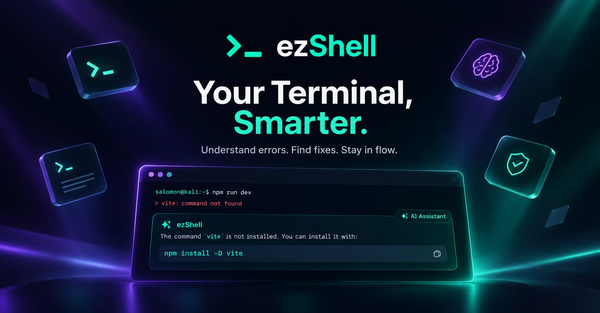

<div align="center">

# ezShell

**Ton terminal t'explique ses erreurs.**
Une commande échoue ? `Alt+E` explique la cause et place une correction dans ton prompt. Tu relis, tu valides : rien n'est exécuté sans toi.


[Site](https://ezshell.vercel.app) · [Fonctionnalités](#fonctionnalités) · [Installation](#installation) · [Utilisation](#utilisation) · [Licence](#licence)



</div>

---

## Fonctionnalités

- **Diagnostic de la dernière erreur** : la cause probable, en français ou en anglais selon ta locale.
- **Correction insérée dans le prompt** : la commande arrive dans ta ligne de saisie ; c'est toi qui appuies sur Entrée.
- **Langage naturel** : tape ta demande (« lister les ports ouverts ») puis `Alt+E` pour obtenir la commande.
- **Niveau de risque** : faible, moyen ou élevé. Les règles locales d'ezShell relèvent le niveau si le modèle le sous-estime, et une commande à risque élevé exige une confirmation explicite (`y`).
- **Sans clé API** : ezShell passe par son service hébergé ; ton appareil reçoit un jeton anonyme avec un quota quotidien gratuit.
- **Secrets masqués** : mots de passe, clés API, jetons, identifiants dans les URL et clés privées sont masqués avant l'envoi, puis une seconde fois sur le serveur.
- **bash, zsh et fish** sur Linux et macOS, **PowerShell** sur Windows (bêta). Une fenêtre de bureau et une interface plein terminal sont aussi disponibles.

---

## Installation

Prérequis : Python 3.10 ou plus récent.

```bash
pipx install git+https://github.com/Waddle-io/ezShell.git
```

Puis branche ezShell sur ton shell, en ajoutant la ligne correspondante à la fin de ton fichier de configuration :

| Shell | Fichier | Ligne |
|---|---|---|
| zsh | `~/.zshrc` | `eval "$(ezsh init zsh)"` |
| bash | `~/.bashrc` | `eval "$(ezsh init bash)"` |
| fish | `~/.config/fish/config.fish` | `ezsh init fish \| source` |
| PowerShell (Windows) | `$PROFILE` | `Invoke-Expression (& ezsh init powershell \| Out-String)` |

Pour bash, zsh et PowerShell, `ezsh init --install` ajoute la ligne à ta place. Ouvre ensuite un nouveau terminal.

**Windows (bêta) :** installe Python 3.10+ et [pipx](https://pipx.pypa.io/stable/), puis la même commande `pipx install` dans PowerShell (5.1 ou 7, avec PSReadLine). Si PowerShell refuse de charger ton profil, autorise les scripts locaux pour ton compte : `Set-ExecutionPolicy -Scope CurrentUser RemoteSigned`. Sous WSL, suis simplement les instructions Linux.

<details>
<summary>Autres méthodes d'installation</summary>

**Installateur en une ligne** (installe dans `~/.local/share/ezshell`, commandes dans `~/.local/bin`) :

```bash
curl -fsSL https://raw.githubusercontent.com/Waddle-io/ezShell/main/install.sh | bash
```

**Depuis les sources :**

```bash
git clone https://github.com/Waddle-io/ezShell.git
cd ezShell
python3 -m venv .venv
source .venv/bin/activate
pip install -e .
```

La fenêtre de bureau nécessite Tk (`sudo apt install python3-tk` sur Debian/Ubuntu).
</details>

Désinstaller : retire la ligne `ezsh init` de ton fichier de configuration, puis `pipx uninstall ezshell`.

---

## Utilisation

### Dans ton terminal (`Alt+E`)

Lance une commande qui échoue (par exemple `git psuh`), puis appuie sur `Alt+E`.

| Touche | Action |
|---|---|
| `Entrée` | Insérer la commande dans le prompt (risque faible ou moyen) |
| `y` | Insérer une commande à risque élevé ou sur plusieurs lignes |
| `e` | Modifier la commande avant de l'insérer |
| `c` | Copier dans le presse-papiers |
| `/` | Poser une autre question |
| `q` / `Échap` | Fermer sans rien insérer |

Pour un diagnostic plus précis, lance la commande via `ezsh run` : la fin de sa sortie d'erreur est gardée (et masquée) pour l'analyse.

```bash
ezsh run -- npm run build
```

`ezsh suggest --ask "trouver les fichiers de plus de 1 Go"` ouvre le même panneau sans raccourci.

### Autres modes

```bash
ezsh                 # fenêtre de bureau (interface terminal si aucun affichage)
ezsh --tui           # interface plein terminal, pratique en SSH
ezsh --explain "docker: Error response from daemon: port is already allocated"
ezsh --check-key     # vérifie que le service ezShell répond
ezsh --version
```

`ezsh --help` liste toutes les options.

### Configuration

Aucune configuration n'est nécessaire. Variables utiles :

| Variable | Rôle |
|---|---|
| `EZSHELL_LANG` | Force la langue (`fr` ou `en`) ; sinon déduite de `$LANG` |
| `EZSH_API_URL` | URL du service (défaut : `https://ezshell.vercel.app`) |
| `EZSH_DIRECT=1` | Appelle Groq directement avec ta propre clé (`GROQ_API_KEY` ou `ezsh --set-key`) |
| `EZSH_MODEL` | Modèle en mode direct (défaut : `openai/gpt-oss-120b`) |
| `EZSH_STATE_DIR` | Dossier d'état par terminal (défaut : `$XDG_RUNTIME_DIR/ezsh`, `%LOCALAPPDATA%\ezsh` sous Windows) |
| `EZSH_MOCK_LLM=1` | Simule le modèle, sans réseau (développement) |

---

## Confidentialité

Rien n'est envoyé tant que tu n'appuies pas sur `Alt+E`. Sont alors envoyés : ton OS et ton shell, le dossier courant (avec `~` à la place de ton nom), la dernière commande, son code de sortie et, si tu passes par `ezsh run`, la fin de sa sortie d'erreur (4 Ko max). Le service ne conserve pas le contenu des requêtes : seulement un jeton d'appareil haché et des compteurs de quota.

---

## Développement

```bash
pip install -e . -r requirements-dev.txt
pytest
ruff check src tests
EZSH_MOCK_LLM=1 ezsh suggest --ask "lister les gros fichiers"
```

Le service hébergé (Next.js + Postgres) est dans [`web/`](web/README.md). Voir aussi [`CONTRIBUTING.md`](CONTRIBUTING.md) et [`DEVELOPMENT.md`](DEVELOPMENT.md).

---

## Licence

Distribué sous licence [MIT](LICENSE). © 2026 Salomon.
